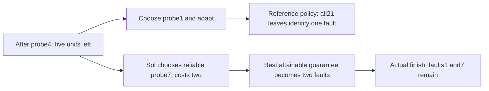

> Archived source excerpt. Original location: `readiness-study-20261031/G1-SOL-CASE-STUDY.md`. Relative links below describe original archive paths. This copy does not assert current live status.

# Sol understood every observation and still spent its way out of a solution

Observed episode: G1 / G05 / `sol-persistent-c5-r3`. This is one prospectively sampled fresh case, not a population error rate. The complete native prompt/answer chain and terminal grade passed the interim replay audit; the full G1 experiment is still running.

The task starts with eight possible faults, six units for tests, and at most one flipped noisy response across the entire investigation. A reliable test costs two units; noisy tests cost one. The goal is to leave the smallest worst-case set of possible faults while preserving uncertainty. Some other bank cases genuinely cannot guarantee a single fault, so the evaluator does not blindly require certainty everywhere.

Sol first chose probe4, received0, and correctly kept all eight possibilities: a single noisy observation cannot exclude a world that would require the one allowed flip. Five units remained, and a complete identification strategy was still possible.

Its next answer said: “Probe 7 reliably partitions them; three repetitions of probe 2 afterward can determine its truthful bit by majority, guaranteeing at most two remaining worlds within budget.” This was a coherent plan for two remaining possibilities. It was less effective than an available adaptive plan for one.

Before the costly test, two independently implemented finite oracles agree that a policy beginning with probe1 can identify one fault. Its21 reachable leaves were replayed against the full observation history and shared error budget. After Sol's chosen probe7 response0, both agree that even the best continuation can only guarantee two. Probe7 disables no other tests here: this failure comes from consuming the remaining testing budget poorly, rather than deleting a needed test as in the earlier development failure.

Sol's reported possible-world set was correct on every turn, including the final set `[1,7]`. Both final worlds have a legal explanation for the entire actual history: world1 requires only observation4 to be flipped; world7 requires only observation3. The evaluator therefore does not declare Sol wrong for admitting uncertainty. It records a terminal planning failure because a single-world outcome was attainable before its decision and became unattainable afterward.

This supports a bounded distinction between tracking evidence and choosing an effective investigation. It does not establish creativity, human engineering ability or production debugging performance. The passing repeats stay visible alongside this failure. Computation recovered all six observed difficult-development-case trials in the separate intervention study, so the no-tool setup remains part of the claim.

Actual episode (historical reference: `g1-fresh/episodes/sol-persistent-c5-r3.json`) · Exact answers (historical reference: `report.html`) · All constructive recovery policies and legal counterhistories (historical reference: `RECOVERY-COUNTEREXAMPLES.json`) · Interim native/oracle audit (historical reference: `g1-fresh/AUDIT-PARTIAL.json`).
