# Build DAG: historical eval-author replication

Status: **implemented with documented deviations; all 31 scheduled author attempts are terminal and adjudicated**. Human task and criterion review remains pending. The original dependency graph and gates below are preserved as the plan, not retroactively asserted as passed. [the prepackaging audit](BUILD-AUDIT-SNAPSHOT.md) maps every node to actual outputs and qualifications; [RESULTS.md](RESULTS.md) records the runs. Parent design: [DESIGN.md](DESIGN.md). Failure evidence: [FAILURE-INVENTORY.md](FAILURE-INVENTORY.md). Machine-readable dependencies: [DAG-PLAN.json](DAG-PLAN.json).

## Outcome and boundary

Build a runnable evaluation of whether GPT can create a sound eval for the **same nine hackathon jobs** in the design. The first formal prompt condition must reproduce the original eval-authoring instruction wherever it is recoverable. If an instruction cannot be recovered, its minimal reconstruction is a separately labeled condition. The explicit “complete runnable eval” checklist is a **coached secondary condition**; it cannot be substituted for the original instruction or pooled with it. No subject repairs its package after seeing owner grading.

The finished local package must contain source-bound input packets, independently qualified owner references and controls, isolated execution, frozen manifests, subject transcripts, per-check grades and a claim-limited report. Historical graders and findings are owner-side comparators, never the authority that grades a new eval. A package that has only task designs or historical counts is not finished.

## Dependency graph

```mermaid
flowchart LR
  D00["D00: claim and scope"] --> D01["D01: recover author instructions"]
  D00 --> D02["D02: source and exposure census"]
  D01 --> D03["D03: packet provenance per H1-H9"]
  D02 --> D03
  D03 --> D04["D04: public-contract matrix per job"]
  D04 --> D05["D05: independent positive references"]
  D04 --> D06["D06: negative and sibling controls"]
  D00 --> D07["D07: isolation and event recorder"]
  D05 --> D08["D08: owner checker per job"]
  D06 --> D08
  D07 --> D08
  D03 --> D09["D09: original/reconstructed prompt packets"]
  D03 --> D10["D10: coached packet, separate arm"]
  D08 --> D11["D11: independent semantic and boundary review"]
  D09 --> D11
  D10 --> D11
  D11 --> D12["D12: preflight and freeze"]
  D12 --> D13["D13: transport calibration"]
  D13 --> D14["D14: formal primary author runs"]
  D14 --> D15["D15: immutable primary scoring"]
  D15 --> D16["D16: optional coached author runs"]
  D16 --> D17["D17: immutable coached scoring"]
  D15 --> D18["D18: independent adjudication"]
  D17 --> D18
  D18 --> D19["D19: synthesis and claim decision"]
  D19 --> D20["D20: reproducible local release"]
```

Nodes D03–D06 and D08 are **nine parallel case lanes**, one each for H1–H9. An unqualified case is recorded as excluded with a reason at D11; it is never silently counted as a successful or negative formal attempt. D16–D17 are optional diagnostics. The primary result and D19 report can complete without them; if skipped, D18 consumes D15 directly.

## Nodes, outputs and gates

| ID | Depends on | Work and durable output | Exit gate |
| --- | --- | --- | --- |
| D00 | — | Freeze objective, unit of analysis, claim classes and conditions in `protocol/CLAIMS.md`. | “GPT builds an eval” is the subject; original, reconstructed and coached conditions have separate IDs. |
| D01 | D00 | Search original conversation/session and saved run records for each **eval-authoring instruction**, not only subject-facing `prompt.txt`. Write `sources/INSTRUCTION-PROVENANCE.json` with exact text/hash, timestamp, source, available tools/files, or `not_recovered`. | No case called exact unless its authoring instruction and exposure are evidenced. |
| D02 | D00 | Inventory the original public task, data, grader, reference, design and failure evidence for H1–H9. Write hash-bound `sources/SOURCE-MANIFEST.json`; label what the new author may see. | Owner-only files and any sensitive material are excluded from author workspace. |
| D03 | D01,D02 | Build one `packets/Hn/PROVENANCE.json` and minimal original/reconstructed input packet per job. Record source bytes and every reconstruction choice. | Packet content matches recorded exposure; reconstruction is explicit; no new checklist in the primary packet. |
| D04 | D03 | For each job, map every proposed owner check to a publicly licensed obligation in `owner/Hn/CONTRACT-MATRIX.md`; enumerate permitted alternatives and ambiguity. | No secret output label, exception, wrapper, timing rule or grading path. Ambiguous cases are revised or excluded before runs. |
| D05 | D04 | Build at least two independently implemented correct alternatives per job; store expected outcomes in owner-only `owner/Hn/POSITIVES.json`. | Both pass the owner semantic oracle under the original public contract. |
| D06 | D04 | Build at least three targeted faulty controls plus a fresh sibling of each historical weakness in `owner/Hn/NEGATIVES.json`. Include wrong behavior, wrong measurement, boundary and accounting cases as applicable. | Every negative violates a named public obligation; at least one checks the original failure and one checks generalization. |
| D07 | D00 | Build `owner/runtime/`: clean workspace builder, owner-bank boundary, nested scored-code isolation, process-event recorder and timeout accounting. | Probe cannot read owner bank or scored eval's private oracle; shell/file/MCP events and invalid launches are distinguishable. Fail closed if isolation unavailable. |
| D08 | D05,D06,D07 | Build an owner checker for each job, using independent semantics and black-box evaluation of the GPT-authored grader. | All owner positives accepted and negatives rejected by owner ground truth; old false alarm controls do not become model failures. |
| D09 | D03 | Freeze original instruction or minimal reconstructed authoring packet per job and its manifest. | Exact and reconstructed packets have different labels; no original grader, answer or private case leaks. |
| D10 | D03 | Build optional coached packet with the explicit quality checklist and common lessons. | Coached bytes and exposure differ from D09 and cannot overwrite it. |
| D11 | D08,D09,D10 | Independent reviewer checks task meaning, reference, mutant fairness, instruction provenance, exposure and isolation. Record decisions in `owner/REVIEW.json`. | All admitted jobs have substantive human review and accepted controls; excluded jobs retain reasons. |
| D12 | D11 | Execute preflight controls; freeze inputs, owner bank, runner, prompt arms, model/run policy and hashes in `FREEZE.json`. | Reference-positive and targeted-negative gates pass; no post-outcome editing of formal conditions. |
| D13 | D12 | Calibrate model access, sandbox, clean workspace, tool transport, time budget and receipt capture. `CALIBRATION.json` marks these calls ineligible. | All requested arms can start and write/read in the intended sandbox; calibration is never a formal trial. |
| D14 | D13 | Run preregistered fresh GPT eval-author attempts on the primary packet, with fixed model/effort/tools/budget and no automatic retry. Save full transcripts and delivered packages under `runs/primary/`. | Every scheduled attempt has terminal status or explicit timeout; no attempt sees owner bank or prior outcome. |
| D15 | D14 | Score immutable primary packages with owner positives/negatives and boundary probes. Save raw checks in `grades/primary/`. | Denominators are attempted/completed/eligible/unknown; false accepts and false rejects preserved. |
| D16 | D15 | **Optional:** run new sessions on coached packets, same owner bank but separately frozen model/run policy. | No primary result is relabeled by coached success; no continuation of a failed primary session. |
| D17 | D16 | Score immutable coached packages under the same owner checker; save `grades/coached/`. | Coached results have their own counts and condition label. |
| D18 | D15; D17 if run | Independently adjudicate every severe error, ambiguous case, timeout and grader incident against raw files. Save `ADJUDICATION.md`. | No model-failure claim rests solely on the GPT-authored grader or on an unqualified owner check. |
| D19 | D18 | Write `RESULTS.md` and a machine ledger: per job/model/condition outcomes, exact examples, historical comparison and limits. | Separate exact, reconstructed and coached conclusions; no pooled global rate or claims from synthetic probes as model cheating. |
| D20 | D19 | Build clean-run local package, README, pinned dependencies, small data, reproduction commands, manifests and representative transcripts. | Independent clean run reproduces the reported owner checks and headline counts; no secrets or owner-only hidden bank leaked to the submitted actor image. |

## Parallel case branches

All nine branches use D03→D04→D05/D06→D08. This table gives each branch's first adversarial target; the full source pointers are in [DESIGN.md](DESIGN.md).

| Job | First owner gate | Separate concern to retain |
| --- | --- | --- |
| H1 E1 ledger | Correct `accepted` and `applied` forms accepted; wrong effects rejected. | Original hidden-literal false failure: 3/3. |
| H2 criteria | Licensed alternative rankings accepted; a truly wrong sheet rejected. | Original claimed hit invalid under unstated clone criterion. |
| H3 temporal | Correct intake-only and conservative outputs adjudicated against explicit timing. | Original apparent over-exclusion was not actual leakage. |
| H4 V6 tests | Subject suite accepts correct reference **and** rejects naive mutant. | Original one of eight suites rejected both. |
| H5 G1F query | Real 180 comparisons reported as 30 rejected; legal unseen scan passes; private oracle unreadable. | Original grader was spoofable; actual Astra/Sol programs did genuine benchmark work. |
| H6 NA numeric | Equivalent zero spellings receive the same correct count; feasible large value accepted. | Original 16/16 saved programs were false greens. |
| H7 DH19 fields | Flat licensed map accepted; wrong evidence rejected. | Original 7/8 wrapper false rejects. |
| H8 custody | All expected turns and snapshots discovered across storage paths. | Original audit missed 72 of 228 snapshots. |
| H9 synthesis | Raw tally, eligible exposure, tool channels and execution claims reconcile. | No-hit labels hid real errors; 75 MCP calls omitted; README command misread as execution. |

## Critical path, stop conditions and completion

**Critical path:** D00 → D01/D02 → D03/D04 → D05/D06/D07/D08 → D11 → D12 → D13 → D14 → D15 → D18 → D19 → D20. Source recovery, case construction and runtime work can proceed in parallel until D11. The coached path D16–D17 is secondary and follows immutable primary scoring.

If no original eval-authoring instruction is recovered for a job, continue with a labeled reconstruction; do not convert the subject-facing prompt into an “exact” authoring prompt. If the independent oracle, public-contract license or isolation cannot be qualified, hold that job out of formal scoring and preserve the failed gate. If the model transport fails, mark the attempt invalid/unknown under the frozen policy and preserve receipts. Do not treat a historical model error, a synthetic mutation or a weak owner checker as a new GPT eval-author failure.

**Done** means every admitted job has a source manifest, instruction provenance, licensed owner checks, positive and negative controls, qualified isolation, a frozen input packet, saved fresh author outputs, immutable grades and an independently reviewed report. D20 produces a reproducible local artifact; external submission is a separate owner action.
