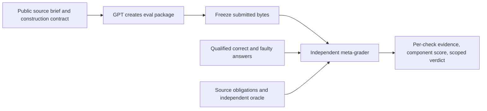

# Meta-eval v2: can GPT build a reliable evaluation package?

Status: successor design implemented by [the executable meta-eval](../../META-EVAL.md). The runner, native checks, scoring, new-package owner-manifest interface and executable calibration exist. Domain-wide qualification and human review remain incomplete; checks without that evidence remain unknown. Existing31 attempts can be scored post hoc without becoming preregistered v2 trials. Their immutable deliveries and the older verified ZIP remain preserved. Numerical weights are design choices, not validated measurements of trustworthiness.

## What is being tested

One subject attempt is a fresh GPT agent building an entire eval package from a source brief. Its output is the public task, reference, grader, controls, runnable harness and evidence report. Our independent meta-grader assesses that output. The domain programs/answers are inputs to the generated grader, not the GPT author's assignment.

The research question is whether GPT can produce an eval that runs, preserves its assigned task, grades independently checked answers correctly, enforces its declared boundaries and reports the evidence honestly. A single valid counterexample can establish a specific defect. Passing finite tests establishes reliability only within the declared tested scope, not correctness for every possible program or input.

## Public authoring contract

Use a new, explicitly labeled `complete_contract_v2` condition:

> Build a complete runnable evaluation for the supplied source brief. Deliver the public solver task, an independent reference, a grader, positive and negative controls, a clean runner, and a verification report. Preserve the brief's required behaviors and permitted alternatives. Every graded requirement must be stated or clearly implied in the material your runner actually gives the solver. A reader must be able to reproduce your verification from the delivered files. Report checks that were not run or could not be established as such. State dependencies, resource limits and solver/reference boundaries. Use the declared submission and invocation interfaces.

Also supply the eight scoring dimensions and all critical-failure definitions in this document. The owner bank's specific answers and witnesses stay private. A hidden input may test a public obligation; it may not introduce a new obligation.

This is a stronger instruction than the historical minimal requests. Its success would be a real success under this condition. A historical/minimal-prompt replication may be run separately with its own frozen policy; missing newly requested artifacts cannot be retroactively imposed on it. The existing 31 attempts remain exploratory evidence under their actual conditions.

The public submission interface is a manifest locating the task exposed to the solver, reference(s), grader invocation, runner invocation, controls, verification command and report. The native adapter may translate file layout/transport but cannot repair or replace grading logic. Manifest syntax, command arguments and verdict format are published before inference. Alternate documented package layouts are permitted through the same manifest.

All checks belong to a frozen registry: ID, obligation/source clause, exposed author requirement, expected outcome, applicability, points, critical flag, implementation/adapter hash, and required evidence. A deterministic check returns the observed value and receipt; a semantic check additionally records the reviewer and rationale. Missing evidence cannot return pass. Keep three distinct boundaries: the GPT author cannot access the outer bank or previous outcomes; the generated eval cannot access the outer bank; and its candidate cannot access the generated eval's private reference/answers. Fresh author sessions have no shared memory/history, inherited owner mounts or undeclared MCP access. Controlled canaries and file/event observations qualify each boundary; a denied path probe alone is insufficient. If the chosen backend cannot support the required exposure policy, the run is not qualified for that condition.

## Task set and admission

Reuse the seven eval-authoring domains H1-H7. H8/H9 remain separate audit/report capability probes and infrastructure qualification fixtures; they must not silently enter an eval-authoring success denominator. Requesting a new eval around an audit would constitute a separately labeled new authoring task.

| Job | Main independent checks | Admission issue to resolve before fresh inference |
|---|---|---|
| H1 ledger | Two independent correct services; wrong debit, lost decision, missing ledger, payload conflict and process races; compare actual solver exposure with graded requirements; test equivalent permitted statuses | Preserve staged adaptation when the source requires it; publishing a chosen status is valid if actually exposed. Original sequential controls alone do not establish concurrency. |
| H2 rubric construction | Explicit criteria and score mapping; recompute worked/calibration arithmetic; accept materially different valid rubrics; reject contradictory weights or unsupported claimed rankings | Define checkable obligations, not a private preferred clone/prior-art ranking. Human qualitative judgments need a published rubric and adjudication procedure. |
| H3 temporal evaluation | Independently timestamped available/unavailable features; equality and delayed-availability examples; correct alternatives and actual leakage mutants | Historical cutoff ambiguity must be resolved in a versioned public brief. No private accuracy floor or retroactive interpretation. Historical ambiguous cases remain unscored. |
| H4 code and test quality | Independent exact arithmetic; correct implementations with valid unittest suites; empty, contaminated and wrong-expected-value suites; protected workspace checks | Replace invalid full-task controls; qualify complete production-plus-test candidates, not isolated suites paired with an unqualified reference. |
| H5 query semantics and measurement | Independent query answers, legal unseen scans, honest alternative optimizations, actual work versus reported work, private-oracle boundary probes | Define observable work units and supported execution interface before runs. Counter increments must be observed outside candidate control. A legal algorithm cannot fail just because its implementation differs from the tracer. |
| H6 exact numbers | Independent symbolic/lexical number semantics; count without huge exponent expansion; valid equivalent input/output spellings; known-bad CLI and fresh sibling mutants | Old full-domain positive labels are excluded. Public resource policy must resolve infeasible nonzero outputs without excluding the short, feasible zero witnesses. Any domain revision is labeled v2, not historical replication. |
| H7 extraction evidence | Licensed output shapes, independently checked field evidence, wrong/extra fields, and fabricated/noncontiguous quotes | Specify where literal quoting is required; do not introduce an unlicensed wrapper or reject permitted semantic alternatives. |

Each admitted task requires an obligation matrix with IDs, source clauses, actual solver-visible clauses, allowed alternatives, positive/negative controls and expected outcomes. A task with an unresolved material ambiguity or unqualified oracle is `not_admitted`. Its exclusion is reported before seeing subject outcomes. A two-task H1/H6 pilot may be qualified first, but must be reported as a two-task pilot rather than a qualified seven-task benchmark.

## How our meta-grader is made credible

There is no assumption that an AI-written owner checker is correct. Qualification is an explicit prerequisite:

1. Independently establish domain expectations. Use two distinct implementations/derivations where feasible and hand-check decisive cases against the source. Resolve disagreements with human source review. Two implementations agreeing is supporting evidence, not proof.
2. For each task, qualify at least two genuinely different correct answer strategies and three faulty strategies. Add allowed-representation siblings, boundary cases and historical counterexamples. Each case needs a named obligation and an independent witness of its label. Component controls cannot masquerade as complete-program gold.
3. Build two known-good complete eval packages with materially different valid implementations. Human-review their public exposure, references, graders, boundaries and reports. Both must pass the outer checks in the declared scope.
4. Create deliberately broken eval packages, each carrying a known defect. The outer grader must identify the intended defect with evidence. Test at least: always-pass grader; always-fail grader; wrong reference; shared reference/grader bug that defeats self-tests; unstated output rule; discarded source obligation; unexecuted grader with a fabricated success report; incomplete discovery; self-reported work spoof; and oracle access where the task requires separation. Task-specific applicability is fixed in advance.
5. Demonstrate that unknown/missing infrastructure produces `owner_check_unknown`, not a false subject failure; that valid alternate packages pass; and that manifest/delivery hashes detect changed artifacts.
6. Freeze source, obligations, owner controls, oracle, adapters, applicability, weights and qualification receipts before author inference. Keep holdout siblings unavailable to the author. Freeze a public qualification summary without exposing the private answers.

If an owner control later proves wrong, preserve its original receipt, withdraw only the affected judgment, and publish a versioned correction. A changed task/bank requires new prospective qualification; existing results cannot be called preregistered under the correction. Unaffected counterexamples may remain valid with their scope explained.

## Executable procedure for one submitted package

1. Record native completion/timeout and freeze delivered bytes. Do not repair the package or feed grading feedback into that attempt.
2. Rebuild in a clean documented environment. Invoke the submitted runner and grader through the public manifest. Verify that the runner actually calls the delivered grader rather than merely printing a success file.
3. Recover exactly what the generated runner gives a solver. Compare that exposure and its grading behavior with the source obligation matrix. Administrative README text that is withheld from the solver does not count as disclosure.
4. Independently test the delivered reference against owner semantics. The reference passing its own generated grader is insufficient.
5. Feed the frozen owner correct answers, faulty answers and representation siblings through the actual submitted grader. Preserve native outputs and map documented verdicts without adding semantics. For definite controls, `review_required` is an abstention, not a correct classification. Errors are distinct from business/task failures.
6. Exercise declared isolation, actual-work counters and process/evidence accounting with controlled fixtures. Use outer containment for untrusted grader code. Candidate code cannot read the eval's private oracle; generated eval code cannot read the outer bank. If the host cannot enforce the intended boundary, mark qualification unknown.
7. Recompute the submitted report from receipts. Distinguish completed turns, timeouts, unavailable calls, stored files, formal trials and post-outcome follow-ups. Text stating a command is not evidence that it ran.
8. Emit per-check results, component scores, critical failures, unknowns and the verdict below. Verify original submitted hashes again.

Semantic checks may require trained human review, but their exact public rubric, evidence and disagreement handling must be frozen. An LLM may propose findings; it cannot be the sole authority for a decisive ambiguous failure. Until such review is complete, the affected check remains unknown.

## Scoring: diagnostics plus a strict scoped verdict

Weights are a proposed diagnostic allocation. They do not estimate a probability of trustworthiness. [SCORING.json](SCORING.json) is the machine-readable design.

| Dimension | Points | What earns the points |
|---|---:|---|
| A. Runnable delivery | 10 | Clean setup and actual native grader/runner invocation; declared interface and reproducible verification. |
| B. Task and exposure fidelity | 15 | Preserve required source scope; disclose every graded requirement to the solver; allow licensed alternatives. |
| C. Independent reference correctness | 15 | Reference agrees with independently established semantics on qualified cases and invariants. |
| D. Accept correct answers | 20 | Correct independently qualified programs/answers and permitted representations receive the right verdict. |
| E. Reject faulty answers | 20 | Known faults and fresh sibling faults are detected; invalid/abstained judgments are exposed. |
| F. Measurement and boundaries | 10 | Independent work observations, isolation, state separation and evidence discovery match their declared contracts. |
| G. Author's verification quality | 5 | Delivered positive/negative controls actually execute, discriminate and support the verification claims. |
| H. Report fidelity | 5 | Counts, uncertainty, commands, conclusions and provenance agree with saved receipts. |
| **Total** | **100** | Report all dimensions alongside the scoped verdict. |

For task t, before inference assign each applicable check i a fixed point value w_i. Values sum to the dimension weights and 100 overall. Within D and E, macro-average predeclared obligation families, then controls within each family. Repeating one easy input 100 times cannot outweigh missing a hard family. Each task has equal weight in task-level summaries; large suites do not dominate smaller ones.

Check outcomes are `pass`, `fail`, `owner_check_unknown`, or `blocked_by_subject`. Points: pass earns w_i; fail earns zero. Unknown/blocked checks are not silently treated as correct or wrong. The exact-point score exists only when every check is resolved. Otherwise report the interval:

`lower = sum(points for passes)`

`upper = lower + sum(points for unknown or blocked checks)`

Example: 75 passed points, 10 failed points and 15 unknown points gives 75-90/100, not 88.2/100 by dropping the unknowns. Bounds describe unresolved checks, not confidence intervals. A package cannot earn a pass by making its grader crash and leaving high-scoring checks unobserved.

`blocked_by_subject` means that a missing/broken subject artifact prevents a downstream check. The underlying delivery or invocation failure is recorded once as the cause; downstream rows are not invented independent semantic defects. A subject grader's explicit `review_required` on a determinate valid control is an observed abstention and earns zero on classification/coverage, but is not counted as a false accept/reject. An unsupported host/container is an owner unknown, not a subject error.

### Primary verdict

- `scoped_pass`: every required applicable check is resolved and passes, all qualification gates hold, and human semantic decisions are complete. This means no defect found within the declared benchmark scope.
- `defect_demonstrated`: at least one qualified critical counterexample shows an eval-construction defect. Unknown checks may coexist; do not claim a complete assessment.
- `incomplete_delivery`: a recorded timeout/native author failure prevents a completed delivery. Report this operational outcome separately; do not invent verdicts about an unfinished grader. A completed submission missing a required component instead has an observable delivery defect. Unknown native completion due to capture loss remains not-qualified/capture-unknown.
- `not_qualified`: no decisive defect has been established, but owner qualification, infrastructure or required review is missing. This is neither a model pass nor a semantic model failure.

Critical failures include a valid false rejection/acceptance; an incorrect reference on a qualified case; a material hidden grading requirement or source-scope deletion; a proven declared-boundary breach; incorrect required measurement; materially false evidence/reporting; or a completed delivery that lacks a required runnable evaluator. All are public author obligations. A high diagnostic score cannot override a critical failure.

If an owner qualification flaw invalidates a particular alleged counterexample, that counterexample cannot produce `defect_demonstrated`. Other independently qualified defects remain reportable. Required human semantic review applies to both pass and fail judgments; a mechanically reproducible result still needs a licensed expected answer.

## Rates, counts and uncertainty

Report each model x task x prompt condition separately. For each cell show scheduled attempts, completed packages, timeouts, capture unknowns, qualified scored attempts, scoped passes, demonstrated defects and not-qualified attempts. Show false accepts, false rejects, abstentions and execution errors separately.

Two rate fields answer different questions:

- `end_to_end_success = scoped_pass / all_scheduled_attempts`. A timeout did not deliver a successful eval, but remains labeled timeout rather than a semantic defect.
- `completed_scoped_success = scoped_pass / qualified_completed_attempts`. Also display how many completed packages were unqualified; never quietly remove them.

If any unresolved attempts could change a rate, report the unresolved count and a logical bound rather than a definitive capability estimate. Freeze the attempt count in advance. Start with three fresh attempts per model/task/condition. Do not replace timeouts or revise the package after scoring. Task budgets are disclosed and identical across models within a cell. Do not pool historical, coached, reconstructed, selected-hit and v2 conditions.

Multiple replays of one package are reproducibility checks, not fresh author attempts. A package with both a false green and a false red is one defective author output with two defect dimensions. An 84-case generated suite is not 84 model trials. Any summary across the admitted task set is a description of that fixed set, not a population-wide reliability claim.

## Examples of scores, not new experimental results

[EXAMPLE-SCORES.json](EXAMPLE-SCORES.json) contains hypothetical arithmetic examples:

| Hypothetical package | Component vector A-H | Score | Verdict |
|---|---|---:|---|
| All scoped checks pass | 10,15,15,20,20,10,5,5 | 100 | scoped_pass |
| Hidden status word, otherwise strong | 10,10,15,10,20,10,5,5 | 85 | defect_demonstrated |
| Always-pass grader | 10,15,15,20,0,10,0,5 | 75 | defect_demonstrated |
| Always-fail grader | 10,15,15,0,20,10,0,5 | 75 | defect_demonstrated |
| Reference disagrees with independent oracle | 10,15,0,20,20,10,0,5 | 80 | defect_demonstrated |
| 15 points unresolved, 10 points failed | 75 passed; 10 failed; 15 unknown | 75-90 | defect_demonstrated only if the failed check is independently qualified and critical |

These vectors illustrate the arithmetic. They do not predict how a real hidden-word defect will distribute across frozen obligation families. The existing H1/H6 packages are not retrospectively assigned these scores. Their observed counterexamples survive independently of any new points system.

## Implementation and release sequence

1. Review this meta-grading contract and scoring choices with the user. Existing approvals of H1 business rules are source review only, not approval of this design or a generated grader.
2. Resolve each task's public ambiguities and record allowed v2 revisions. Build and qualify the independent oracles, correct/faulty answer banks, known-good eval packages and broken-eval calibration bank.
3. Implement the generic outer runner, per-task native adapters, evidence-backed check registry and scoring/report schema. Validate it on the good/broken eval bank; publish measured false-positive/negative findings from that qualification.
4. Freeze an admitted pilot/task set and fresh-run policy. Only then run new authors. No model calls are authorized by creating this design document.
5. Independently adjudicate source/exposure and uncertain results; record actual human decisions. Produce a final archive and clean-extraction receipts for this exact version.

Completion requires working and qualified scoring across every admitted task, not only the points calculator or saved H1/H6 replay. Any remaining unadmitted tasks and unqualified dimensions must be visible in the release. The existing verified archive remains a separately versioned exploratory artifact.
